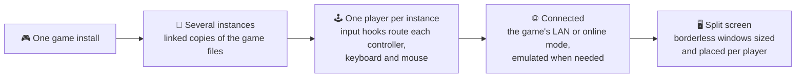
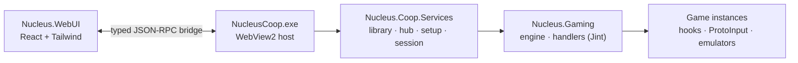

<div align="center">


# Nucleus Co-op

### One PC. One copy of the game. Everyone on the couch.

Split-screen for PC games that never shipped with it. Free and open source.


[](https://github.com/SplitScreen-Me/splitscreenme-nucleus/releases/latest)
[](https://github.com/SplitScreen-Me/splitscreenme-nucleus/releases)
[](https://discord.gg/QDUt8HpCvr)
[](https://patreon.com/nucleus_coop)
[](LICENSE)

**[Download](https://github.com/SplitScreen-Me/splitscreenme-nucleus/releases/latest)** &nbsp;·&nbsp;
**[600+ games on the Hub](https://hub.splitscreen.me)** &nbsp;·&nbsp;
**[Install guide](https://www.splitscreen.me/docs/installation)** &nbsp;·&nbsp;
**[FAQ](https://www.splitscreen.me/docs/faq)** &nbsp;·&nbsp;
**[Discord](https://discord.gg/QDUt8HpCvr)**

<br>


<sub>Nucleus Co-op 3, the new interface being built on this branch.</sub>

</div>

<br>

## Why Nucleus Co-op

<table>
<tr>
<td width="50%" valign="top">

### 🖥️ Any screen, any layout
Split one monitor in two, four, six, eight or sixteen, place players by hand, or spread them over several monitors.

</td>
<td width="50%" valign="top">

### 🎮 Every player gets their own input
Xbox and DirectInput controllers, and several keyboards and mice on the same PC, each one sent to one player only.

</td>
</tr>
<tr>
<td width="50%" valign="top">

### 📦 600+ games, ready to play
Community-made handlers on the [Hub](https://hub.splitscreen.me). Pick a game, install its handler in one click, point Nucleus to the game, play.

</td>
<td width="50%" valign="top">

### 💸 Free, open, no account
GPL-3.0, no sign-up, no ads. Built by players for players, and supported by the community on Patreon.

</td>
</tr>
</table>

## How it works



Nucleus starts several instances of the same game from a single install, using symlinked copies of its files and closing the mutexes that would stop a second copy. Each instance answers to one player only, through custom XInput libraries, XInput Plus or ProtoInput hooks. The instances connect through the game's own LAN or online mode, with Goldberg or Nemirtingas emulators when it needs Steam, Epic or Galaxy. Nucleus keeps every window active so all players can play at once, then removes the borders and sizes and places each window on its part of the screen.

> [!IMPORTANT]
> Nucleus doesn't add multiplayer to single-player games. The game needs some form of LAN or online multiplayer, or a mod that connects its instances.

Each game needs a **handler**: a small JavaScript file written by the community that tells Nucleus how to start, hook and connect that game. Hundreds are ready on the [Hub](https://hub.splitscreen.me), and anyone can [write one](https://www.splitscreen.me/docs/create-handlers).

## Get started

1. **Install the requirements.** Windows 10 or 11, [.NET Framework 4.7.2](https://dotnet.microsoft.com/en-us/download/dotnet-framework/thank-you/net472-web-installer) or later, and the Visual C++ 2015-2022 Redistributable, both [x86](https://aka.ms/vs/17/release/vc_redist.x86.exe) and [x64](https://aka.ms/vs/17/release/vc_redist.x64.exe). Nucleus Co-op 3 also needs the [Microsoft Edge WebView2 Runtime](https://developer.microsoft.com/en-us/microsoft-edge/webview2/consumer/), already present on most PCs.
2. **Download the [latest release](https://github.com/SplitScreen-Me/splitscreenme-nucleus/releases/latest)** and extract it into its own folder, for example `C:\NucleusCo-op`. Avoid `Program Files`, your user folder and OneDrive.
3. **Add a game.** Find it on the Hub and install its handler, then show Nucleus where the game's executable is.
4. **Set up the session.** Everyone presses a button on their controller to join, pick a layout, launch.

The [installation guide](https://www.splitscreen.me/docs/installation), the [usage guide](https://www.splitscreen.me/docs/usage) and the [keyboard and mouse setup](https://www.splitscreen.me/docs/kbm-setup) cover the details.

## Nucleus Co-op 3

> [!NOTE]
> **Work in progress on the `v3.0.0-wip` branch.** The stable version is the 2.x line on the [releases page](https://github.com/SplitScreen-Me/splitscreenme-nucleus/releases).

Version 3 replaces the WinForms window with a new interface, written in React and hosted in WebView2. Handlers, hooks and settings files don't change, so handlers from the Hub work as they are.

<table>
<tr>
<td width="58%">

</td>
<td width="42%" valign="top">

- **A library that does the work.** Nucleus finds your Steam and Epic games that have a handler on the Hub and adds them in one go.
- **The Hub built in.** Browse, install and update handlers without leaving the app.
- **Controller first.** Press any button to join, then drive the whole app with a pad.
- **Clear errors.** Problems with a handler or a launch show up in the app instead of pop-up boxes.
- **Lighter.** The download is about 20 % smaller than 2.x, and the app's own libraries live in `bin\`.

</td>
</tr>
</table>

## Build from source

<details>
<summary><b>Requirements and commands</b></summary>

<br>

**You need** Visual Studio 2022 or its Build Tools with the C++ workload (MSVC v143 and a Windows SDK), the .NET SDK to run the tests, Node.js 22.12 or later, and git.

```powershell
git clone -c core.longpaths=true https://github.com/SplitScreen-Me/splitscreenme-nucleus.git
cd splitscreenme-nucleus
git switch v3.0.0-wip

# 1. Web interface (the C# build copies dist\ into the app)
cd Master\Nucleus.WebUI
npm ci
npm run build
cd ..\..

# 2. Solution
& "C:\Program Files (x86)\Microsoft Visual Studio\2022\BuildTools\MSBuild\Current\Bin\MSBuild.exe" `
  Master\NucleusCoop.sln -restore -p:Configuration=Release -m

# 3. Native components: hooks, injectors and ProtoInput (fetches the submodule)
powershell -ExecutionPolicy Bypass -File Master\tools\build-native.ps1 -Configuration Release -NoReferenceBuild
```

The app lands in `Master\NucleusCoopTool\bin\Release`.

**Working on the interface:** `npm run dev` runs it in a browser against a mock of the app. In a Debug build, a `webui\dev-server.txt` file holding the Vite URL makes the real app load the dev server with hot reload.

**Tests:** `npm run typecheck` and `npm run test:bridge` for the interface, `dotnet test` on the compiled `Nucleus.Coop.Services.Tests` and `Nucleus.Bridge.Tests` assemblies for the C# side.

**Changing the bridge:** edit the C# contracts in `Master/Nucleus.Bridge/Contracts`, then `npm run bridge:gen`. `npm run bridge:check` fails when the generated TypeScript is out of date.

</details>

### How the code fits together



| Folder | What it is |
|---|---|
| `Master/NucleusGaming` | The engine: runs handler scripts, prepares and starts instances, routes input, places windows |
| `Master/NucleusCoopTool` | `NucleusCoop.exe`, the WebView2 window that hosts the interface |
| `Master/Nucleus.WebUI` | The interface, in React, TypeScript and Tailwind |
| `Master/Nucleus.Bridge` | The JSON-RPC bridge: C# contracts are the source of truth, the TypeScript is generated |
| `Master/Nucleus.Coop.Services` | The services behind the bridge: library, hub, downloads, setup, session, settings |
| `Master/StartGame`, `Master/Nucleus.Inject` | Helper processes that start games and inject hooks |
| `Master/Nucleus.Hook`, `Master/Nucleus.SHook` | Native hooks (C++) |
| `Submodules/ProtoInput` | Several keyboards and mice, input hooks |

The design notes are in [`docs/webui`](docs/webui): [architecture](docs/webui/architecture.md), [bridge how-to](docs/webui/bridge-howto.md), [host window](docs/webui/host.md), [library](docs/webui/library-services.md) and [setup](docs/webui/setup-services.md) services.

## Contribute

Bug reports, handlers and code are all welcome. The [contributing guide](CONTRIBUTING.md) explains how to report a bug and how to work on the codebase, and the [handler guide](https://www.splitscreen.me/docs/create-handlers) gets you started on your first handler.

## Community

- 💬 [Discord](https://discord.gg/QDUt8HpCvr), where most of the help and handler work happens
- 🗨️ [r/nucleuscoop](https://www.reddit.com/r/nucleuscoop/) on Reddit
- 🌐 [splitscreen.me](https://www.splitscreen.me/docs/what-is-splitscreen-me), the website and docs
- 🧡 [Patreon](https://patreon.com/nucleus_coop), and the [list of all-time supporters](https://github.com/SplitScreen-Me/splitscreenme-patreon/tree/main)

## Credits

| Who | What |
|---|---|
| [Lucas Assis (lucasassislar)](https://github.com/lucasassislar) | The original Nucleus Co-op |
| [ZeroFox](https://github.com/ZeroFox5866) | Nucleus Co-op Alpha 8 Mod |
| [Ilyaki](https://github.com/Ilyaki) | ProtoInput, USS, multiple keyboards and mice, hooks |
| [Mikou27](https://github.com/Mikou27) | Nucleus Co-op 2.0 and later |
| [r-mach](https://github.com/r-mach) | Website, Hub and handler API, Nucleus Co-op 3 interface |
| [Talos91](https://github.com/Talos910), [PoundlandBacon](https://github.com/PoundlandBacon), [Pizzo](https://github.com/Bizzo499), [maxine64](https://github.com/Maxine202) and many more | Handlers, testing, feedback and improvements |

<details>
<summary><b>Third-party tools Nucleus Co-op uses</b></summary>

<br>

| Tool | Author |
|---|---|
| [Goldberg Emulator](https://gitlab.com/Mr_Goldberg/goldberg_emulator) | Mr_Goldberg |
| [SmartSteamEmu](https://github.com/MAXBURAOT/SmartSteamEmu) | syahmixp |
| [Steamless](https://github.com/atom0s/Steamless) | atom0s |
| [x360ce](https://github.com/x360ce/x360ce) | EJocys |
| [XInput Plus](https://sites.google.com/site/0dd14lab/xinput-plus) | 0dd14 Lab |
| [ForceBindIP](https://r1ch.net/projects/forcebindip) | r1ch |
| [Flawless Widescreen](https://www.flawlesswidescreen.org/) | HaYDeN |
| [devreorder](https://github.com/briankendall/devreorder) | briankendall |
| [DirectXWrapper](https://community.pcgamingwiki.com/files/file/87-the-bards-tale-2005-windowed-mode/) | VerGreeneyes |
| dinput8 blocker | wizark952 |
| [Epic / Galaxy emulators](https://gitlab.com/Nemirtingas), [OpenXinput](https://github.com/Nemirtingas/OpenXinput) | Nemirtingas |
| SplitCalculator | Josivan88 |

</details>

Special thanks to the SplitScreenDreams Discord community: none of this would exist without their work.

## License

Nucleus Co-op is free software under the [GNU General Public License v3.0](LICENSE).

<div align="center">
<br>
<sub>Made by the <a href="https://github.com/SplitScreen-Me">SplitScreen.Me</a> community, for every couch with one PC and too many friends.</sub>
</div>
