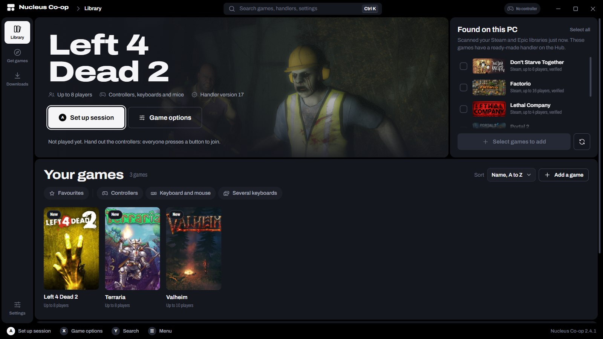
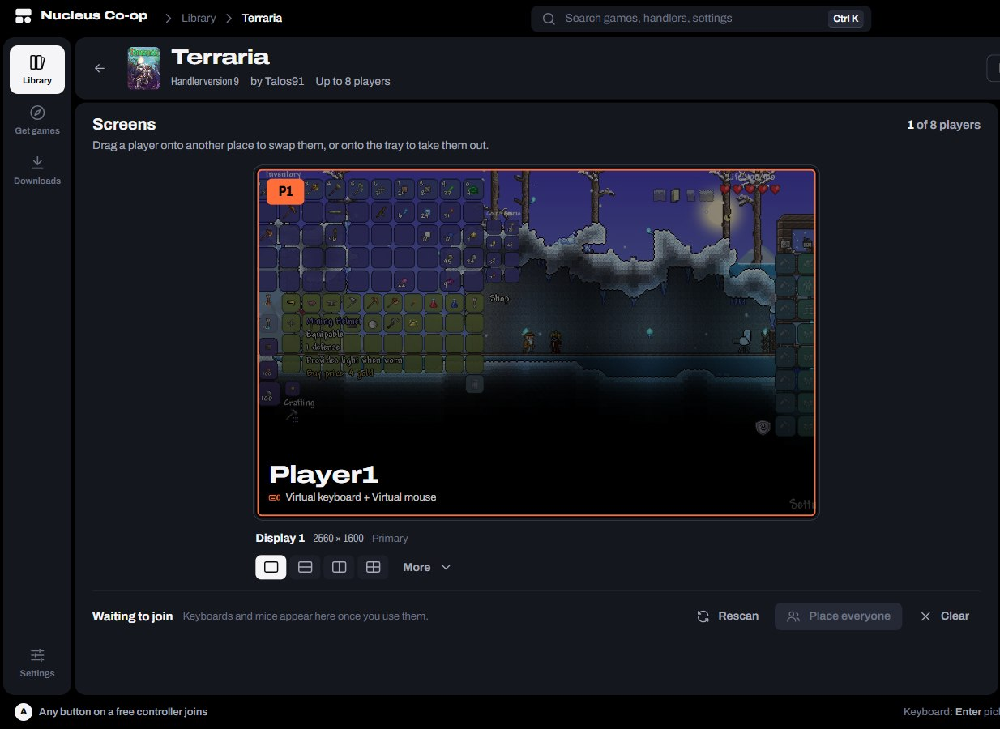
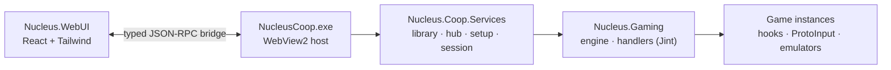

<div align="center">


# Nucleus Co-op

### Split-screen for PC games that never had it.

Grab a controller, pull up a chair. Nucleus Co-op turns one PC and one copy of a game<br>into a couch co-op session for up to 32 players. Free and open source.


[](https://github.com/SplitScreen-Me/splitscreenme-nucleus/releases/latest)
[](https://github.com/SplitScreen-Me/splitscreenme-nucleus/releases)
[](https://discord.gg/QDUt8HpCvr)
[](LICENSE)

### [⬇️ Download](https://github.com/SplitScreen-Me/splitscreenme-nucleus/releases/latest) &nbsp;&nbsp; [🔎 Find your game](https://hub.splitscreen.me) &nbsp;&nbsp; [💬 Get help](https://discord.gg/QDUt8HpCvr)

<br>



<sub>The new Nucleus Co-op 3 interface, coming soon.</sub>

</div>

<br>

## Your PC is the console now

Left 4 Dead 2 with four players on one TV. Stardew Valley with your partner on the couch. Valheim with the whole family across two monitors. If a game has LAN or online multiplayer, there's a good chance Nucleus Co-op can split it.

<table>
<tr>
<td width="33%" valign="top">

### 🎮 Bring any controller
Xbox, PlayStation, generic pads, even several keyboards and mice at once. Every player gets their own.

</td>
<td width="33%" valign="top">

### 🖥️ Split it your way
Two, four, six, eight or sixteen players on one screen, or one player per monitor.

</td>
<td width="33%" valign="top">

### 💿 One copy is enough
Every player's game runs from the same install, on the same PC.

</td>
</tr>
<tr>
<td width="33%" valign="top">

### 📦 600+ games ready
Community-made handlers on the [Hub](https://hub.splitscreen.me) do the setup for you. One click and you're in.

</td>
<td width="33%" valign="top">

### ⚡ Press a button to join
Players join from their own controller. Pick a layout, hit Launch.

</td>
<td width="33%" valign="top">

### 💸 Free. For real.
Open source. No account, no ads, no catch.

</td>
</tr>
</table>

**Played with Nucleus Co-op:** Borderlands 2 · Left 4 Dead 2 · Terraria · Valheim · Stardew Valley · Don't Starve Together · Elden Ring · Dark Souls III · Deep Rock Galactic · Risk of Rain 2 · Halo: The Master Chief Collection · Lethal Company · Portal 2 · Satisfactory · Sons of the Forest · 7 Days to Die · Factorio · **[and 600+ more on the Hub →](https://hub.splitscreen.me)**

## Three steps to couch co-op

**1. Pick a game.** Find it on the [Hub](https://hub.splitscreen.me), install its handler, and show Nucleus where the game is.

**2. Grab the controllers.** Everyone presses a button to join and takes a spot on the screen.

**3. Hit Launch.** Nucleus opens one copy of the game per player, gives each one their own controls, connects them together and lays the windows out on your screen.

> [!IMPORTANT]
> Nucleus Co-op needs a game with some form of LAN or online multiplayer, or a mod that adds one. It can't turn a single-player game into a co-op game.

<details>
<summary><b>How does it actually work?</b></summary>

<br>

Nucleus starts several instances of the same game from a single install, using symlinked copies of its files and closing the mutexes that would stop a second copy. Each instance answers to one player only, through custom XInput libraries, XInput Plus or ProtoInput hooks. The instances connect through the game's own LAN or online mode, with Goldberg or Nemirtingas emulators when it needs Steam, Epic or Galaxy. Nucleus keeps every window active so all players can play at once, then removes the borders and sizes and places each window on its part of the screen.

Each game needs a **handler**: a small JavaScript file written by the community that tells Nucleus how to start, hook and connect that game. Anyone can [write one](https://www.splitscreen.me/docs/create-handlers).

</details>

## Get started

1. **Install the requirements:** Windows 10 or 11, [.NET Framework 4.7.2](https://dotnet.microsoft.com/en-us/download/dotnet-framework/thank-you/net472-web-installer) or later, and the Visual C++ 2015-2022 Redistributable, both [x86](https://aka.ms/vs/17/release/vc_redist.x86.exe) and [x64](https://aka.ms/vs/17/release/vc_redist.x64.exe).
2. **Download the [latest release](https://github.com/SplitScreen-Me/splitscreenme-nucleus/releases/latest)** and extract it into its own folder, for example `C:\NucleusCo-op`. Keep it out of `Program Files`, your user folder and OneDrive.
3. **Run `NucleusCoop.exe`** and add your first game.

New here? The [installation guide](https://www.splitscreen.me/docs/installation), the [usage guide](https://www.splitscreen.me/docs/usage) and the [keyboard and mouse setup](https://www.splitscreen.me/docs/kbm-setup) walk you through it. Game won't start? Check [the troubleshooting page](https://www.splitscreen.me/docs/doesnt-launch) and the [FAQ](https://www.splitscreen.me/docs/faq).

## Coming next: Nucleus Co-op 3

> [!NOTE]
> Nucleus Co-op 3 is in development on the `v3.0.0-wip` branch. The stable version is the 2.x line on the [releases page](https://github.com/SplitScreen-Me/splitscreenme-nucleus/releases).

A whole new interface, built around the couch.

<table>
<tr>
<td width="58%">

</td>
<td width="42%" valign="top">

- **Finds your games.** Nucleus scans your Steam and Epic libraries and adds every game that has a handler, in one go.
- **The Hub built in.** Browse, install and update handlers without leaving the app.
- **Made for the couch.** Press any button to join, then drive the whole app with a controller.
- **Clear when it fails.** Problems show up in the app, with what to do next, instead of pop-up boxes.
- **Lighter.** About 20 % smaller to download than 2.x.

Your handlers and settings carry over as they are.

</td>
</tr>
</table>

## Need help?

- 💬 **[Discord](https://discord.gg/QDUt8HpCvr)**: the fastest way to get help, and where handlers are made
- 🗨️ **[r/nucleuscoop](https://www.reddit.com/r/nucleuscoop/)** on Reddit
- 📖 **[splitscreen.me](https://www.splitscreen.me/docs/what-is-splitscreen-me)**: guides, FAQ and troubleshooting

## For developers

Want to add a game? [Write a handler](https://www.splitscreen.me/docs/create-handlers) and share it on the Hub. Want to work on the app? Start with the [contributing guide](CONTRIBUTING.md).

<details>
<summary><b>Build from source</b></summary>

<br>

**You need** Visual Studio 2022 or its Build Tools with the C++ workload (MSVC v143 and a Windows SDK), the .NET SDK to run the tests, Node.js 22.12 or later, and git.

```powershell
git clone -c core.longpaths=true https://github.com/SplitScreen-Me/splitscreenme-nucleus.git
cd splitscreenme-nucleus
git switch v3.0.0-wip

# 1. Interface (the C# build copies dist\ into the app)
cd Master\Nucleus.WebUI
npm ci
npm run build
cd ..\..

# 2. Solution
& "C:\Program Files (x86)\Microsoft Visual Studio\2022\BuildTools\MSBuild\Current\Bin\MSBuild.exe" `
  Master\NucleusCoop.sln -restore -p:Configuration=Release -m

# 3. Native components: hooks, injectors and ProtoInput (fetches the submodule)
powershell -ExecutionPolicy Bypass -File Master\tools\build-native.ps1 -Configuration Release -NoReferenceBuild
```

The app lands in `Master\NucleusCoopTool\bin\Release`.

- **Interface work:** `npm run dev` runs it in a browser against a mock of the app. In a Debug build, a `webui\dev-server.txt` file holding the Vite URL makes the app load the dev server with hot reload.
- **Tests:** `npm run typecheck` and `npm run test:bridge` for the interface, `dotnet test` on the compiled `Nucleus.Coop.Services.Tests` and `Nucleus.Bridge.Tests` assemblies for the C# side.
- **Bridge changes:** edit the C# contracts in `Master/Nucleus.Bridge/Contracts`, then `npm run bridge:gen`. `npm run bridge:check` fails when the generated TypeScript is out of date.

</details>

<details>
<summary><b>How the code fits together</b></summary>

<br>



| Folder | What it is |
|---|---|
| `Master/NucleusGaming` | The engine: runs handler scripts, prepares and starts instances, routes input, places windows |
| `Master/NucleusCoopTool` | `NucleusCoop.exe`, the WebView2 window that hosts the interface |
| `Master/Nucleus.WebUI` | The interface, in React, TypeScript and Tailwind |
| `Master/Nucleus.Bridge` | The JSON-RPC bridge: C# contracts are the source of truth, the TypeScript is generated |
| `Master/Nucleus.Coop.Services` | The services behind the bridge: library, hub, downloads, setup, session, settings |
| `Master/StartGame`, `Master/Nucleus.Inject` | Helper processes that start games and inject hooks |
| `Master/Nucleus.Hook`, `Master/Nucleus.SHook` | Native hooks (C++) |
| `Submodules/ProtoInput` | Several keyboards and mice, input hooks |

Design notes: [architecture](docs/webui/architecture.md), [bridge how-to](docs/webui/bridge-howto.md), [host window](docs/webui/host.md), [library](docs/webui/library-services.md) and [setup](docs/webui/setup-services.md) services.

</details>

## The story

This repository is the official version of Nucleus Co-op, part of the [SplitScreen.Me](https://www.splitscreen.me/docs/what-is-splitscreen-me) organization. It builds on the [Nucleus Co-op Alpha 8 Mod](https://github.com/ZeroFox5866/nucleuscoop), itself based on the original Nucleus Co-op, and has grown with a reworked interface, proper support for display scaling, player nicknames, a new player and input order, many more handler options and a long list of fixes. The full story is on [splitscreen.me](https://www.splitscreen.me/docs/history).

## Credits

| Who | What |
|---|---|
| [Lucas Assis (lucasassislar)](https://github.com/lucasassislar) | The original Nucleus Co-op |
| [ZeroFox](https://github.com/ZeroFox5866) | Nucleus Co-op Alpha 8 Mod |
| [Ilyaki](https://github.com/Ilyaki) | ProtoInput, USS, multiple keyboards and mice, hooks |
| [Mikou27](https://github.com/Mikou27) | Nucleus Co-op 2.0 and later |
| [r-mach](https://github.com/r-mach) | Website, Hub and handler API, Nucleus Co-op 3 interface |
| [Talos91](https://github.com/Talos910), [PoundlandBacon](https://github.com/PoundlandBacon), [Pizzo](https://github.com/Bizzo499), [maxine64](https://github.com/Maxine202) and many more | Handlers, testing, feedback and improvements |

<details>
<summary><b>Third-party tools Nucleus Co-op uses</b></summary>

<br>

| Tool | Author |
|---|---|
| [Goldberg Emulator](https://gitlab.com/Mr_Goldberg/goldberg_emulator) | Mr_Goldberg |
| [SmartSteamEmu](https://github.com/MAXBURAOT/SmartSteamEmu) | syahmixp |
| [Steamless](https://github.com/atom0s/Steamless) | atom0s |
| [x360ce](https://github.com/x360ce/x360ce) | EJocys |
| [XInput Plus](https://sites.google.com/site/0dd14lab/xinput-plus) | 0dd14 Lab |
| [ForceBindIP](https://r1ch.net/projects/forcebindip) | r1ch |
| [Flawless Widescreen](https://www.flawlesswidescreen.org/) | HaYDeN |
| [devreorder](https://github.com/briankendall/devreorder) | briankendall |
| [DirectXWrapper](https://community.pcgamingwiki.com/files/file/87-the-bards-tale-2005-windowed-mode/) | VerGreeneyes |
| dinput8 blocker | wizark952 |
| [Epic / Galaxy emulators](https://gitlab.com/Nemirtingas), [OpenXinput](https://github.com/Nemirtingas/OpenXinput) | Nemirtingas |
| SplitCalculator | Josivan88 |

</details>

Special thanks to the SplitScreenDreams Discord community: none of this would exist without their work.

## License

Nucleus Co-op is free software under the [GNU General Public License v3.0](LICENSE).

## Support the project

Nucleus Co-op is free and will stay free. If it gave you a great night on the couch, you can help keep it going.

<a href="https://patreon.com/nucleus_coop"></a>

Thank you to [every supporter, past and present](https://github.com/SplitScreen-Me/splitscreenme-patreon/tree/main) 🧡

<div align="center">
<br>
<sub>Made by the <a href="https://github.com/SplitScreen-Me">SplitScreen.Me</a> community, for every couch with one PC and too many friends.</sub>
</div>
